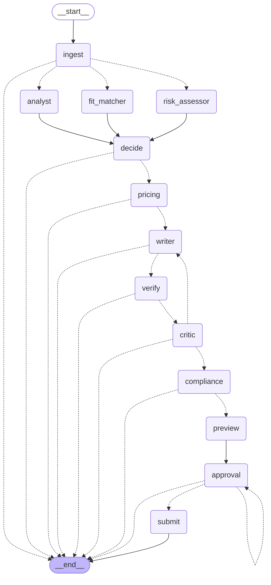
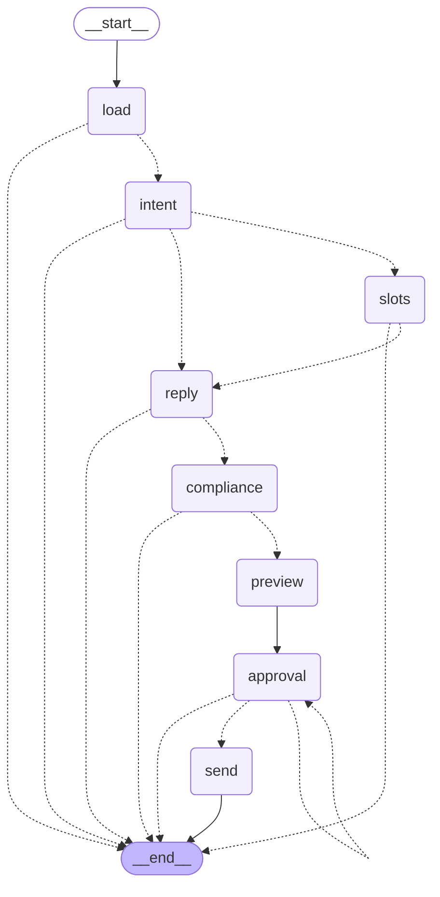

# Architecture

GigBid is a multi-agent freelancer copilot. Two LangGraph graphs do the work; MCP servers are the only way they touch
the outside world; a human approves every outgoing proposal, message and Connects spend.

```
 React UI (apps/web) --SSE/REST--> FastAPI (apps/api) --runs--> LangGraph graphs (agent/graphs)
                                       |   ^                         |  tools only via MCP (agent/mcp_client.py)
                         Arq worker ---+   | approvals resume        v
                         (schedules)       | interrupt()   Marketplace MCP --MarketplacePort--> GigSim | Upwork MCP
                                           |               Portfolio MCP  --> RAG pipeline (rag/)
                     Postgres: checkpointer + memory store  Workspace MCP  --> calendar + email drafts
```

## Bid graph (one thread per job), rendered from code

Job Analyst, Risk Assessor and Fit Matcher run in parallel (`Send`); the Critic can send a draft back at most twice;
Compliance can block; `approval` is an `interrupt()` that only the UI resumes; `submit` is the only node that writes.

## Conversation graph (one thread per client conversation), rendered from code


## Why each agent exists
| Agent | Model | Why it is separate |
|---|---|---|
| Scout | none (deterministic) | Runs on a schedule, dedups (id + fingerprint), must be cheap and polite to the marketplace. |
| Job Analyst | small (gpt-oss-20b) | Turns untrusted prose into a typed JobSpec the Writer and Critic share. Degrades to a tag-based spec. |
| Risk Assessor | none (config rules) | Runs on every job; must be fast, explainable (every flag quotes its trigger) and un-jailbreakable. Scam P/R 1.0 on dev and holdout. |
| Fit Matcher | none + retrieval | Maps each requirement to portfolio evidence through the Portfolio MCP; coverage judged only from retrieved text. |
| Decision | none (config rules) | Skip / watch / bid with reasons; rules in config so the change request is a config edit. |
| Pricing Strategist | none (market stats) | Price from client budget, market quantiles and the floor; expected-value check on Connects. |
| Proposal Writer | strong (gpt-oss-120b) | The only creative step; every claim must cite evidence ids. |
| Claim verifier | cross-encoder (no LLM) | Removes claims the evidence does not support BEFORE the Critic sees the draft (R5). |
| Critic | strong | Grounding / personalisation / length review; bounded revision loop. |
| Compliance Guard | none (policy rules) | Removes contact details and guarantees, blocks off-platform/free-work/fabricated years, re-checks human edits. |
| Executor | none | The only code that writes to the marketplace, after approval, with idempotency keys derived from the thread. |
| Client Liaison | strong (+ small intent model) | Intent (rule override for scam signals), slots from the calendar, reply draft; same approval gate. |

LLMs are used where judgement on language is needed (analyse, write, critique, reply); everything that decides money,
safety or platform rules is deterministic and configurable. That keeps the cost per job at fractions of a cent and makes
every decision explainable in the viva.

## State, trace and memory are kept apart
- **State** (`agent/state.py`): typed `BidState` / `ConversationState` with reducers for parallel writes
  (`evidence`, `critiques`, `steps`, `tokens_used`, and a `halt` channel with a severity reducer). Checkpointed per node
  by the Postgres checkpointer (SQLite locally).
- **Execution trace**: every node appends a short step (node, summary, model, latency, cost) to `trace`; full tool
  payloads go to the MCP audit logs (`data/audit/*.jsonl`) under the same trace id the API created.
- **Long-term memory** (`agent/memory`): LangGraph store, written ONLY by `MemoryManager` through explicit promotion
  rules: style rules need the same edit in 3 distinct threads with no contradiction; outcome insights need >= 10
  outcomes per arm and non-overlapping Wilson 90% intervals. Raw tool output never enters memory. The UI shows and
  deletes promoted items.

## Marketplace port (R1)
`agent/marketplace_port.py` defines one `MarketplacePort` and marketplace-neutral models. Two adapters: GigSim (REST)
and live Upwork (official MCP over Streamable HTTP, OAuth 2.1 with tokens encrypted per user). The Marketplace MCP
server wraps the port, so the graphs see the same tools in both modes; switching is `MARKETPLACE_MODE`.

## Failure handling (C7)
Every node is wrapped (`agent/graphs/common.py`): step/token budget -> `needs_attention`; marketplace unreachable after
bounded retries -> `queued_marketplace_down` (resumed by the scheduler); other repeated failure -> `dead_letter`.
Cheap nodes have a fallback model; structured output retries in JSON-schema mode when a tool call is malformed.

## Durability (C6)
Approvals are `interrupt()`s stored in the checkpointer, so they survive refreshes and API restarts; the executor's
idempotency keys make a replayed submit a no-op (tests: `test_crash_while_waiting_then_resume_on_new_process`).

## Deployment
- Local: `docker compose -f infra/docker-compose.yml up` (web, api, worker, 3 MCP servers over HTTP, GigSim, Postgres,
  Redis; Ollama with `--profile local-llm`).
- Public: one Render free service (`render.yaml`, `infra/docker/all-in-one.Dockerfile`) + Neon Postgres. See
  `docs/adr/0004-production-rag-variant.md` for why production uses V2.
